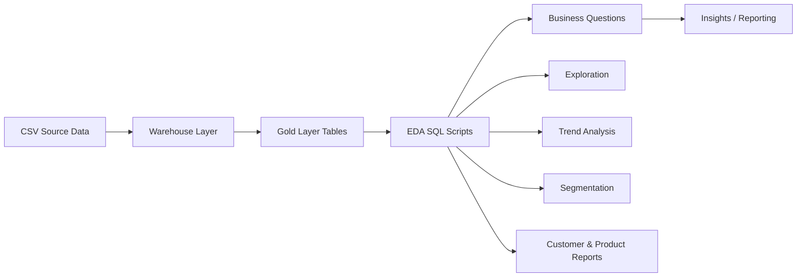
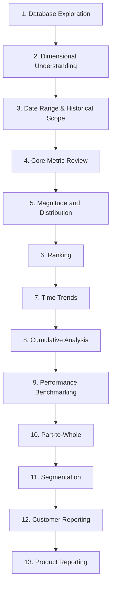

# Exploratory Data Analysis (EDA) for the Data Warehouse

This folder contains the analytical exploration layer built on top of the warehouse created in the main project. The work here is designed to answer business questions with SQL, uncover patterns in customer and product behavior, and turn raw warehouse tables into actionable insight.

The EDA is not a separate database or a standalone app. It is a structured exploration workflow that reads from the Gold layer and applies analytical thinking to uncover trends, anomalies, and opportunities.

---

## Why this EDA exists

A data warehouse is only valuable when it supports insight. Raw tables and dimensions are useful for storage and process integrity, but business value comes from analyzing what the data means.

This EDA layer answers questions such as:

- Which customers are most valuable?
- Which products generate the most revenue?
- How is sales performance changing over time?
- Which categories contribute most to overall revenue?
- Are there customers or products that underperform or need attention?
- Which customer groups should be targeted for retention or growth?

In short, this project translates warehouse data into business understanding.

---

## Business objective

The EDA focuses on the business dimensions that matter most in a sales data warehouse:

- customer behavior
- product performance
- sales trends over time
- revenue concentration and segmentation
- customer and product reporting metrics

The analysis is built entirely around the Gold layer tables:

- `gold.dim_customers`
- `gold.dim_products`
- `gold.fact_sales`

---

## EDA workflow and architecture



### Meaning of each stage

1. Source data is ingested into the warehouse.
2. Gold tables provide a clean analytical model.
3. EDA scripts query those tables to understand structure and behavior.
4. Results generate actionable insights for decision-making.

This is a classic analytical pipeline: source data -> warehouse -> deeper business understanding.

---

## What is being analyzed

### Customer dimension
The customer dataset is used to understand:

- customer distribution by country and gender
- age-related patterns
- spending behavior and customer lifetime value indicators
- customer segments such as VIP, Regular, and New

### Product dimension
The product data is used to answer:

- which categories drive revenue
- which products are high performers
- product cost distribution and pricing patterns
- product segment performance

### Sales fact table
The fact table is the central analytics object. It connects:

- order number
- product
- customer
- order date
- shipment and due dates
- quantity sold
- sales amount
- price

This allows the EDA to calculate revenue, quantity, trends, recency, and performance across all dimensions.

---

## Folder structure

```text
EDA/
├── datasets/
│   └── csv_files/
├── docs/
│   └── Project_Roadmap.png
├── scripts/
│   ├── 01_database_exploration.sql
│   ├── 02_dimensions_exploration.sql
│   ├── 03_date_range_exploration.sql
│   ├── 04_measures_exploration.sql
│   ├── 05_magnitude_analysis.sql
│   ├── 06_ranking_analysis.sql
│   ├── 07_change_over_time_analysis.sql
│   ├── 08_cumulative_analysis.sql
│   ├── 09_performance_analysis.sql
│   ├── 09_performance_analysis (1).sql
│   ├── 10_part_to_whole_analysis.sql
│   ├── 11_data_segmentation.sql
│   ├── 12_report_customers.sql
│   └── 13_report_products.sql
├── README.md
└── .gitkeep
```

---

## Project roadmap and concept map

The project follows a clear analytical progression:



This sequence is important because it moves from understanding the data to making insight-driven conclusions.

---

## Script-by-script explanation

### 01. Database exploration
File: `scripts/01_database_exploration.sql`

What it does:
- inspects the database structure
- lists tables and schemas
- checks metadata for columns in the customer dimension

Why it matters:
Before analysis, the analyst must understand what exists in the warehouse. This step validates the model and prevents wrong joins or assumptions.

How it is done:
- `INFORMATION_SCHEMA.TABLES`
- `INFORMATION_SCHEMA.COLUMNS`

Key concept:
- schema and metadata discovery

---

### 02. Dimensions exploration
File: `scripts/02_dimensions_exploration.sql`

What it does:
- identifies unique countries in customer data
- lists unique product categories, subcategories, and products

Why it matters:
This helps establish the real scope of customer and product dimensions, and confirms that the distribution is as expected.

Key concept:
- dimension profiling

---

### 03. Date range exploration
File: `scripts/03_date_range_exploration.sql`

What it does:
- finds the first and last order dates
- calculates duration in months
- identifies oldest and youngest customer birthdates

Why it matters:
Temporal understanding is essential to detect whether the dataset covers enough time for trend and seasonality analysis.

Key concepts:
- historical window analysis
- time-span measurement
- age analysis using `DATEDIFF`

---

### 04. Measures exploration
File: `scripts/04_measures_exploration.sql`

What it does:
- calculates total sales
- calculates total quantity sold
- calculates average price
- counts orders and products
- creates a single summary of key metrics

Why it matters:
This is the first high-level analytical view of business performance. It gives a top-level KPI snapshot before deeper analysis.

Key concepts:
- KPI aggregation
- summarization
- business metric consolidation

---

### 05. Magnitude analysis
File: `scripts/05_magnitude_analysis.sql`

What it does:
- total customers by country
- total customers by gender
- total products by category
- category cost trends
- total revenue by category
- revenue by customer
- sold units by country

Why it matters:
This is about scale and distribution. It answers: where is activity concentrated? which categories matter most? which customers or geographies contribute the most?

Key concepts:
- grouping and aggregation
- revenue concentration
- distribution analysis
- left joins from dimensions to fact table to retain dimension completeness

Important analytical point:
The script intentionally shows a distinction between starting from the fact table and starting from the dimension table. This matters because the fact table contains only sold products, while the dimension table contains all products, including those with zero sales.

---

### 06. Ranking analysis
File: `scripts/06_ranking_analysis.sql`

What it does:
- identifies top products by revenue
- identifies worst-performing products
- ranks the top customers by revenue
- finds low-order customers
- uses `RANK()`, `ROW_NUMBER()`, and `TOP` to rank records

Why it matters:
Ranking helps prioritize attention. It tells the business which products or customers deserve focus, investment, or retention actions.

Key concepts:
- ranking
- top/bottom analysis
- window functions
- performance comparison

Analytical insight:
The script also demonstrates that simply using `TOP 3` can produce misleading results when many records have identical low values. Ranking with `RANK()` is more meaningful for tied results.

---

### 07. Change over time analysis
File: `scripts/07_change_over_time_analysis.sql`

What it does:
- analyzes sales by year and month
- tracks total sales, customers, and quantity over time
- uses `DATETRUNC()`, `YEAR()`, `MONTH()`, and `FORMAT()`

Why it matters:
Time-based analysis is essential for understanding seasonality, growth, and revenue volatility.

Key concepts:
- time-series analysis
- monthly aggregation
- date truncation
- trend observation

Important note:
The script demonstrates a practical SQL lesson: `FORMAT()` produces text output, which can sort alphabetically instead of chronologically. This matters when building reporting logic.

---

### 08. Cumulative analysis
File: `scripts/08_cumulative_analysis.sql`

What it does:
- calculates monthly sales totals
- shows running totals within each year
- calculates year-level running totals
- includes moving averages

Why it matters:
This type of analysis tells whether growth is accelerating, steady, or declining over time.

Key concepts:
- cumulative totals
- running totals
- moving averages
- time-window aggregation

---

### 09. Performance analysis
Files:
- `scripts/09_performance_analysis.sql`
- `scripts/09_performance_analysis (1).sql`

What it does:
- compares product sales to average product performance
- compares current sales to previous-year sales
- calculates year-over-year change
- shows whether a product is above or below average

Why it matters:
This is a benchmarking analysis. It identifies strong performers, weak performers, and trends over time.

Key concepts:
- year-over-year analysis
- `LAG()` for previous-period comparison
- moving benchmark comparisons
- conditional labeling with `CASE`

Business value:
This turns trend data into clear categories such as:
- Increase
- Decrease
- Above Avg
- Below Avg

---

### 10. Part-to-whole analysis
File: `scripts/10_part_to_whole_analysis.sql`

What it does:
- calculates each category’s contribution to total sales
- computes percentage of total revenue per category

Why it matters:
This reveals how much each category contributes to business performance. It is very useful for prioritization and resource allocation.

Key concepts:
- proportional analysis
- contribution analysis
- window function aggregation over total

---

### 11. Data segmentation
File: `scripts/11_data_segmentation.sql`

What it does:
- segments products into cost ranges
- creates customer segments such as VIP, Regular, and New

Why it matters:
Segmentation allows tailored business actions. For example:

- high-cost products are strategic or premium items
- VIP customers may need dedicated retention efforts
- new customers may need onboarding and conversion support

Key concepts:
- segment logic using `CASE`
- cohort grouping
- targeted analytical marketing and business strategy

---

### 12. Customer report
File: `scripts/12_report_customers.sql`

What it does:
Creates a customer-level report view with:

- customer name and age
- age group
- customer segment
- total orders
- total sales
- total quantity
- total products purchased
- customer lifespan
- recency
- average order value
- average monthly spend

Why it matters:
This is the operational reporting layer for customer analytics. It gives a single customer snapshot for business review and segmentation.

Key concept:
- customer 360 reporting

This file is especially important because it combines raw transactions and customer dimensions into a single customer scorecard.

---

### 13. Product report
File: `scripts/13_report_products.sql`

What it does:
Creates a product-level report view with:

- product name, category, subcategory, cost
- last sale date
- time since last sale
- product segment
- total orders
- total sales
- total quantity
- total customers
- average selling price
- average order revenue
- average monthly revenue

Why it matters:
This provides a complete view of product performance and helps answer business questions like:

- which products are underperforming?
- which categories need attention?
- which products should be promoted?
- which products have become stale or inactive?

Key concept:
- product performance reporting

---

## Core analytical concepts used throughout the EDA

### 1. Aggregation
Aggregation summarizes data into totals, counts, averages, and distributions.

Examples:
- total sales by month
- total customers by country
- average product cost by category

### 2. Grouping
Grouping divides data into meaningful subsets by dimension.

Examples:
- by country
- by gender
- by category
- by product name

### 3. Ranking
Ranking prioritizes items based on a chosen metric.

Examples:
- top 5 products by revenue
- lowest performing customers by order count

### 4. Time-series analysis
Time-series analysis reveals patterns across dates and periods.

Examples:
- monthly revenue trend
- year-over-year customer growth
- seasonality detection

### 5. Cumulative analysis
Cumulative totals show how values build over time.

Examples:
- running revenue total by month
- moving average trend

### 6. Part-to-whole analysis
This shows how each slice contributes to the overall whole.

Examples:
- category share of revenue
- contribution of each customer segment to total sales

### 7. Segmentation
Segmentation creates business-friendly grouping logic.

Examples:
- VIP vs Regular vs New customer groups
- high-, mid-, and low-performing products

### 8. KPI generation
This turns raw data into business metrics that can be acted on.

Examples:
- average order value
- average monthly spend
- recency in months
- lifetime sales per customer

---

## Business questions this EDA is designed to answer

This EDA supports a wide range of commercially relevant questions:

- Which countries drive the most revenue?
- Which products contribute most to sales?
- Are there seasonal trends in the business?
- Which customer segments buy most often?
- Which customers are at risk of churn or low engagement?
- Which product categories are underperforming?
- How does customer spending vary by age or country?
- What are the strongest and weakest product segments?

These are exactly the types of questions that a good warehouse-backed EDA should answer.

---

## Why the approach is effective

This EDA is effective because it follows a disciplined flow:

1. Understand the data structure
2. Understand the available dimensions and measures
3. Evaluate volume and distribution
4. Rank and compare performance
5. Observe change over time
6. Analyze proportion and segment behavior
7. Build reporting views for stakeholders

This is a realistic and practical data analysis path used in business intelligence and analytics work.

---

## Practical execution order

To reproduce the analysis in order, run the SQL scripts in this sequence:

1. `01_database_exploration.sql`
2. `02_dimensions_exploration.sql`
3. `03_date_range_exploration.sql`
4. `04_measures_exploration.sql`
5. `05_magnitude_analysis.sql`
6. `06_ranking_analysis.sql`
7. `07_change_over_time_analysis.sql`
8. `08_cumulative_analysis.sql`
9. `09_performance_analysis.sql`
10. `10_part_to_whole_analysis.sql`
11. `11_data_segmentation.sql`
12. `12_report_customers.sql`
13. `13_report_products.sql`

The scripts are intentionally ordered to move from discovery to deeper analytical interpretation.

---

## Note on duplicate performance script

There are two files named:

- `09_performance_analysis.sql`
- `09_performance_analysis (1).sql`

They appear to contain the same content and likely represent duplicate exploratory work. This is not unusual in iterative analysis, but it is worth noting when reviewing the project history.

---

## Documentation asset

A roadmap image is available in:

- `docs/Project_Roadmap.png`

This visual complements the SQL exploration flow and helps communicate the progression of analysis.

---

## Summary

This EDA folder is the analytical heart of the project. It turns a structured warehouse into a practical understanding of customers, products, and sales behavior.

It is important because it demonstrates:

- how to inspect and profile warehouse data
- how to analyze patterns and trends
- how to identify top performers and weak signals
- how to segment and report customer and product performance
- how to turn data into decisions

This is not simply exploratory querying; it is a structured business analytics workflow built directly on top of the warehouse.
