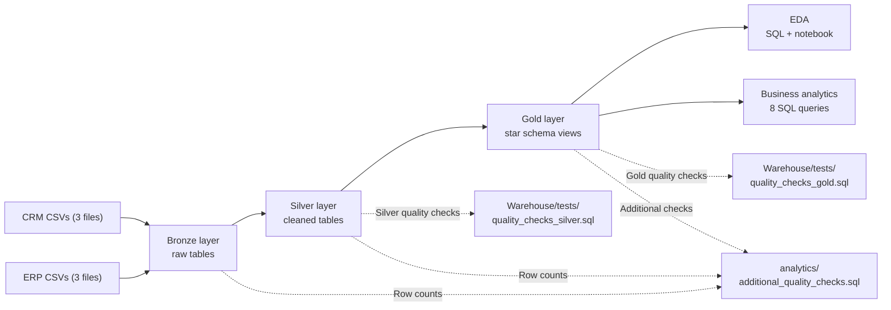
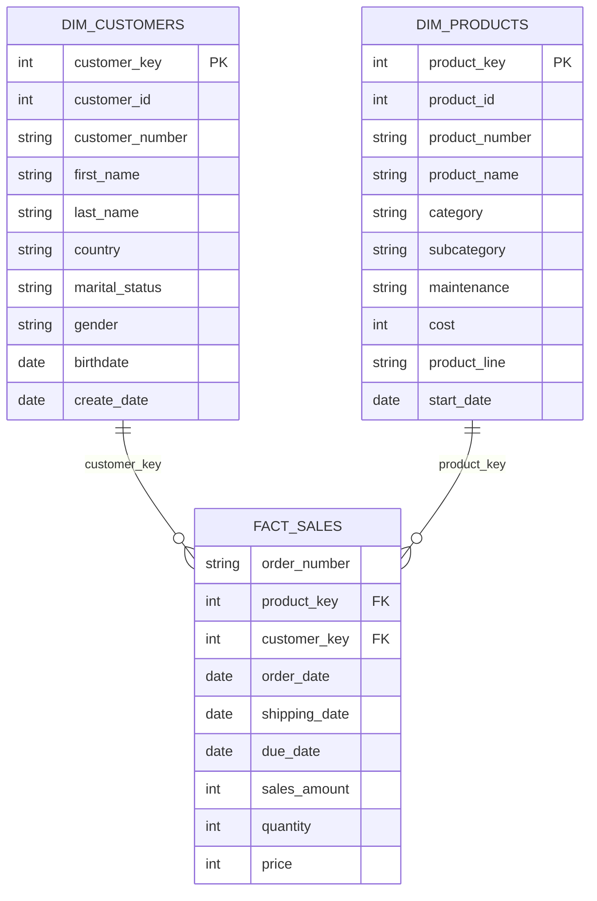

# SQL Data Warehouse and Business Analytics

An end-to-end SQL Server project that integrates CRM and ERP source data into a Bronze–Silver–Gold data warehouse, explores it with SQL and Python, answers eight business questions, and validates data quality.

## Table of Contents

1. [Overview](#1-overview)
2. [Problem Statement](#2-problem-statement)
3. [Project Objectives](#3-project-objectives)
4. [Architecture](#4-architecture)
5. [Technologies Used](#5-technologies-used)
6. [Dataset Description](#6-dataset-description)
7. [Repository Structure](#7-repository-structure)
8. [Warehouse Implementation](#8-warehouse-implementation)
9. [Exploratory Data Analysis](#9-exploratory-data-analysis)
10. [Business Analytics](#10-business-analytics)
11. [Data Quality Validation](#11-data-quality-validation)
12. [Key Findings](#12-key-findings)
13. [Setup and Execution Guide](#13-setup-and-execution-guide)
14. [Limitations and Future Improvements](#14-limitations-and-future-improvements)
15. [Learning Outcomes](#15-learning-outcomes)
16. [Acknowledgements](#16-acknowledgements)
17. [Author](#17-author)

---

## 1. Overview

This project builds a data warehouse in Microsoft SQL Server from six CSV files exported from two source systems (a CRM and an ERP). Raw data is loaded, cleaned, and remodeled into a **star schema** (one fact view and two dimension views). On top of that model the project provides:

- exploratory data analysis (EDA) in SQL and a Python notebook,
- eight business-analysis SQL queries,
- additional data quality checks,
- written business insights.

## 2. Problem Statement

Customer, product, and sales data live in separate CRM and ERP systems. The raw files contain inconsistent formats, missing values, duplicates, and coded values that are hard to read. Analysing the raw tables directly makes reporting slow and error-prone, and two analysts could easily produce different numbers.

Businesses need one reliable, integrated dataset for decision-making. This project addresses that by:

- loading the raw data unchanged first (so it can always be traced back),
- cleaning, standardizing, and de-duplicating it in a separate layer,
- exposing a simple star schema that analysts can query with plain SQL,
- adding checks that show whether the data can be trusted.

## 3. Project Objectives

- Integrate CRM and ERP data.
- Build a structured data warehouse.
- Clean and standardize data.
- Create analytical fact and dimension tables.
- Perform exploratory analysis.
- Answer business questions using SQL.
- Validate data quality.
- Generate business insights.

## 4. Architecture

The project follows the **medallion (Bronze / Silver / Gold)** pattern.



| Layer | Responsibility | Objects |
|---|---|---|
| Bronze | Load the source CSVs as-is with `BULK INSERT`; no business logic. | Tables in schema `bronze` |
| Silver | Clean, standardize, de-duplicate, and integrate the data. | Tables in schema `silver` |
| Gold | Business-ready star schema for reporting and analysis. | Views in schema `gold` |

## 5. Technologies Used

| Technology | Use in this repository |
|---|---|
| Microsoft SQL Server | Database engine (the Bronze loader reads files from `/var/opt/mssql/import/`, the Linux SQL Server path) |
| T-SQL | Warehouse scripts, stored procedures, EDA, analytics, quality checks |
| DBeaver | Running SQL scripts (as documented in `Warehouse/README.md`) |
| Python, Pandas, NumPy | Analysis in `analytics/warehouse_analytics.ipynb` |
| Jupyter Notebook | The analysis notebook |
| Matplotlib, Seaborn | Charts saved in `analytics/plots/` |
| Git and GitHub | Version control |

Development was done on Ubuntu Linux (documented in `Warehouse/README.md`). No BI dashboard tool (Power BI, Metabase) and no Docker setup is part of this repository.

## 6. Dataset Description

Located in [`Warehouse/datasets/`](Warehouse/datasets). Six source CSV files:

| System | File | Bronze table | Purpose |
|---|---|---|---|
| CRM | `cust_info.csv` | `bronze.crm_cust_info` | Customer master data |
| CRM | `prd_info.csv` | `bronze.crm_prd_info` | Product master data (with start/end dates) |
| CRM | `sales_details.csv` | `bronze.crm_sales_details` | Sales transactions (order lines) |
| ERP | `CUST_AZ12.csv` | `bronze.erp_cust_az12` | Customer birthdate and gender |
| ERP | `LOC_A101.csv` | `bronze.erp_loc_a101` | Customer country |
| ERP | `PX_CAT_G1V2.csv` | `bronze.erp_px_cat_g1v2` | Product category and subcategory |

[`EDA/datasets/csv_files/`](EDA/datasets/csv_files) holds exported snapshots of the Bronze, Silver, and Gold objects. They are used by the Python notebook.

## 7. Repository Structure

```text
Sql-Data-WareHouse/
├── Warehouse/
│   ├── datasets/        source_crm/, source_erp/ (6 source CSV files)
│   ├── scripts/         database_init.sql, bronze/, silver/, gold/
│   ├── tests/           quality_checks_silver.sql, quality_checks_gold.sql
│   ├── docs/            requirements, naming conventions, data catalog, diagrams
│   └── README.md
├── EDA/
│   ├── datasets/csv_files/   exported Bronze/Silver/Gold snapshots
│   ├── docs/                 Project_Roadmap.png
│   ├── scripts/              01 to 13 exploratory SQL scripts
│   └── README.md
├── analytics/
│   ├── business_queries.sql
│   ├── additional_quality_checks.sql
│   ├── business_insights.md
│   ├── Project_Explanation.md
│   ├── warehouse_analytics.ipynb
│   ├── requirements.txt
│   └── plots/
└── README.md
```

| Folder | Purpose |
|---|---|
| `Warehouse/` | The data warehouse: source data, ETL scripts, tests, documentation. |
| `EDA/` | Exploratory SQL scripts that profile and analyse the Gold layer. |
| `analytics/` | Business queries, extra quality checks, insights, Python notebook, and charts. |

## 8. Warehouse Implementation

All scripts are in [`Warehouse/scripts/`](Warehouse/scripts).

| Step | Script | What it does |
|---|---|---|
| Initialization | `database_init.sql` | Creates the `DataWarehouse` database (if missing) and the `bronze`, `silver`, `gold` schemas. Non-destructive. |
| Bronze tables | `bronze/ddl_bronze.sql` | Creates the six raw tables. |
| Bronze load | `bronze/load_procedure_bronze.sql` | Stored procedure `bronze.load_bronze` loads the CSVs with `BULK INSERT`. |
| Silver tables | `silver/ddl_silver.sql` | Creates the six cleaned tables. |
| Silver load | `silver/load_procedure_silver.sql` | Stored procedure `silver.load_silver` truncates and reloads Silver (full load). |
| Gold | `gold/ddl_gold.sql` | Creates the Gold views. |

**Silver transformations** (from `load_procedure_silver.sql`): de-duplication with `ROW_NUMBER()`, product validity dates with `LEAD()`, conversion of integer-coded dates to `DATE` (invalid dates become NULL), and recalculation of invalid sales or price values.

**Gold star schema**



- `gold.dim_customers`: CRM customers enriched with ERP gender, birthdate, and country.
- `gold.dim_products`: current products (`prd_end_dt IS NULL`) with ERP category data.
- `gold.fact_sales`: **one row per product within an order** (order line grain).
- Surrogate keys (`customer_key`, `product_key`) are generated with `ROW_NUMBER()`.

Column descriptions: [`Warehouse/docs/data_catalog.md`](Warehouse/docs/data_catalog.md). Warehouse details: [`Warehouse/README.md`](Warehouse/README.md).

## 9. Exploratory Data Analysis

Thirteen SQL scripts in [`EDA/scripts/`](EDA/scripts), run in order. See [`EDA/README.md`](EDA/README.md) for a script-by-script explanation.

| # | Script | Topic |
|---|---|---|
| 01–04 | database, dimensions, date range, measures exploration | Structure, distinct values, date coverage, key totals |
| 05 | `05_magnitude_analysis.sql` | Totals by category, country, customer |
| 06 | `06_ranking_analysis.sql` | Top and bottom products and customers |
| 07 | `07_change_over_time_analysis.sql` | Sales trends |
| 08 | `08_cumulative_analysis.sql` | Running totals |
| 09 | `09_performance_analysis.sql` | Yearly product sales vs. product average and previous year (`LAG`) |
| 10 | `10_part_to_whole_analysis.sql` | Contribution to total |
| 11 | `11_data_segmentation.sql` | Customer and product segments |
| 12–13 | `12_report_customers.sql`, `13_report_products.sql` | Consolidated report views |

The notebook [`analytics/warehouse_analytics.ipynb`](analytics/warehouse_analytics.ipynb) loads the exported Gold CSVs with Pandas and saves eight charts to [`analytics/plots/`](analytics/plots): revenue by country, revenue by category, monthly sales trend, customer segments, age groups, top products, product segments, and yearly sales.

## 10. Business Analytics

[`analytics/business_queries.sql`](analytics/business_queries.sql) answers eight questions. All queries read from the Gold layer only.

| # | Business question | Main techniques |
|---|---|---|
| 1 | Which products earn the most revenue? | JOIN, GROUP BY on `product_key`, TOP |
| 2 | Which customers earn the most revenue? | JOIN, GROUP BY, TOP with tie-breaker |
| 3 | Monthly revenue and month-over-month growth | CTE, date functions (`DATEADD`, `DATEDIFF`), `LAG()` window function |
| 4 | Which categories perform well or underperform? | CTE, `SUM() OVER`, `COUNT() OVER`, conditional `CASE` |
| 5 | What is the average order value? | CTE (order-level totals), `AVG` |
| 6 | Which countries generate the most revenue? | JOIN, GROUP BY, `COUNT(DISTINCT)` |
| 7 | What share of revenue comes from the top 10 customers? | CTEs, `ROW_NUMBER()`, `CROSS JOIN` |
| 8 | Which customers have not purchased recently (90+ days)? | CTE, `MAX`, date functions |

Business assumptions (documented in the file header): AOV is calculated per order (not per line); "recent" is measured against the latest order date in the data; a category is "underperforming" when its revenue share is below 50% of an equal share. Customers without purchases are excluded from revenue queries; orders with NULL dates are excluded from time-based queries.

Explanations of every query for interview preparation: [`analytics/Project_Explanation.md`](analytics/Project_Explanation.md).

## 11. Data Quality Validation

| Location | Scope |
|---|---|
| [`Warehouse/tests/quality_checks_silver.sql`](Warehouse/tests/quality_checks_silver.sql) | Cleaning rules in the Silver layer |
| [`Warehouse/tests/quality_checks_gold.sql`](Warehouse/tests/quality_checks_gold.sql) | Surrogate key uniqueness and fact-to-dimension integrity |
| [`analytics/additional_quality_checks.sql`](analytics/additional_quality_checks.sql) | Extra Gold checks and cross-layer row counts |

Checks in `additional_quality_checks.sql` (all read-only):

| # | Check | Type |
|---|---|---|
| 1–2 | Duplicate customer and product keys | Fail if rows returned |
| 3 | NULLs in mandatory dimension columns | Fail if rows returned |
| 4a | Fact rows with NULL `order_date` | Informational |
| 4b | Future dates or ship/due date before order date | Fail if rows returned |
| 5 | Zero/negative values, or `sales_amount <> quantity * price` | Fail if rows returned |
| 6 | NULL or orphaned customer/product keys in the fact table | Fail if rows returned |
| 7 | Duplicate rows at the fact grain (order + product) | Fail if rows returned |
| 8 | Row counts across Bronze, Silver, Gold | Informational (differences are expected) |

These matter because a wrong key or duplicated fact row silently changes every revenue number downstream.

## 12. Key Findings

Full details, formulas, and limitations: [`analytics/business_insights.md`](analytics/business_insights.md).

| Topic | Result |
|---|---|
| Total revenue | 29,356,250 across 27,659 orders and 18,484 customers |
| Top products | The top 10 products (Mountain-200 and Road-150 variants) earn about 42.5% of revenue |
| Customer concentration | The top 10 customers earn only about 0.45% of revenue; revenue is not concentrated |
| Revenue trend | 2011: 7.08M, 2012: 5.84M, 2013: 16.34M |
| Categories | Bikes 96.5%, Accessories 2.4%, Clothing 1.2% |
| Average order value | About 1,061 per order |
| Countries | United States 31.2% and Australia 30.9% of revenue |
| Inactive customers | 13,550 of 18,484 last purchased more than 90 days before the last order date (28 Jan 2014) |

## 13. Setup and Execution Guide

### Prerequisites (Ubuntu Linux)

- Microsoft SQL Server for Linux, running and reachable.
- A SQL client: DBeaver or `sqlcmd`.
- Python 3 with `venv` (only for the notebook).
- Git.

### Steps

1. **Clone the repository**

   ```bash
   git clone https://github.com/abhishekkp00/Sql-Data-WareHouse.git
   cd Sql-Data-WareHouse
   ```

2. **Place the datasets where SQL Server can read them.** The Bronze loader reads from `/var/opt/mssql/import/`:

   ```bash
   sudo mkdir -p /var/opt/mssql/import
   sudo cp Warehouse/datasets/source_crm/*.csv Warehouse/datasets/source_erp/*.csv /var/opt/mssql/import/
   sudo chown -R mssql:mssql /var/opt/mssql/import
   ```

   If your import folder differs, edit the six `FROM '...'` paths in `Warehouse/scripts/bronze/load_procedure_bronze.sql`.

3. **Run the scripts in this order** (in DBeaver use **Execute SQL Script**, `Alt+X`, so that `GO` separators are handled):

   | Order | Script |
   |---|---|
   | 1 | `Warehouse/scripts/database_init.sql` |
   | 2 | `Warehouse/scripts/bronze/ddl_bronze.sql` |
   | 3 | `Warehouse/scripts/bronze/load_procedure_bronze.sql`, then `EXEC bronze.load_bronze;` |
   | 4 | `Warehouse/scripts/silver/ddl_silver.sql` |
   | 5 | `Warehouse/scripts/silver/load_procedure_silver.sql`, then `EXEC silver.load_silver;` |
   | 6 | `Warehouse/scripts/gold/ddl_gold.sql` |
   | 7 | `Warehouse/tests/quality_checks_silver.sql` and `Warehouse/tests/quality_checks_gold.sql` |

4. **Run the business queries and extra checks** (database `DataWarehouse` selected):

   ```bash
   sqlcmd -S localhost -U <user> -P '<password>' -C -d DataWarehouse -i analytics/business_queries.sql
   sqlcmd -S localhost -U <user> -P '<password>' -C -d DataWarehouse -i analytics/additional_quality_checks.sql
   ```

   Or open the files in DBeaver and run them as scripts. `sqlcmd` is typically in `/opt/mssql-tools18/bin/`.

5. **(Optional) Run the EDA scripts** `EDA/scripts/01_...sql` to `13_...sql` in numeric order.

6. **(Optional) Run the notebook**

   ```bash
   python3 -m venv .venv && source .venv/bin/activate
   pip install -r analytics/requirements.txt
   cd analytics && jupyter notebook warehouse_analytics.ipynb
   ```

   The notebook reads `../EDA/datasets/csv_files/` and writes charts to `analytics/plots/`.

## 14. Limitations and Future Improvements

**Limitations**

- Full truncate-and-reload ETL; no incremental loading or history of changes.
- The pipeline is run manually; there is no scheduler.
- `sales_amount`, `price`, and `cost` are whole numbers (`INT`).
- The data runs from December 2010 to January 2014, and the first and last months are partial.
- Gold keeps only current products, so historical product versions are not analysed.
- The 90-day inactivity rule and the 50% category rule are assumptions, not business-defined rules.
- No automated test runner; checks are SQL scripts that are reviewed manually.

**Possible improvements**

- Incremental loads and slowly changing dimensions for history.
- Scheduled pipeline execution and run logging.
- Automated pass/fail data quality monitoring.
- Interactive BI dashboard on top of the Gold layer.

## 15. Learning Outcomes

- Designing a layered (medallion) warehouse and a star schema.
- Writing T-SQL ETL with stored procedures and `BULK INSERT`.
- Data cleaning: de-duplication, standardization, date validation.
- Analytical SQL: joins, CTEs, aggregation, window functions, date functions.
- Choosing the right grain (for example order-level AOV and `COUNT(DISTINCT)`).
- Writing data quality checks and separating failures from informational results.
- Validating results independently and documenting assumptions and limitations honestly.
- Basic Python data analysis and visualization with Pandas, Matplotlib, and Seaborn.

## 16. Acknowledgements

The Bronze–Silver–Gold warehouse (database setup, ETL scripts, Gold views, and the source datasets) follows the learning project **SQL Data Warehouse Project** by Data With Baraa: <https://github.com/DataWithBaraa/sql-data-warehouse-project>.

| Based on the original tutorial | Added by me |
|---|---|
| Warehouse architecture, Bronze/Silver/Gold ETL, Gold star schema, source CSV files | EDA scripts and EDA documentation, Python notebook and charts, eight business queries, additional data quality checks, business insights, project explanation, repository organization, and this README |

## 17. Author

**Abhishek Kr Prajapati**
GitHub: [@abhishekkp00](https://github.com/abhishekkp00)
