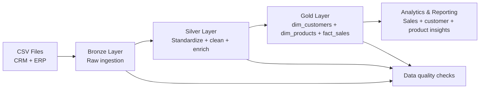
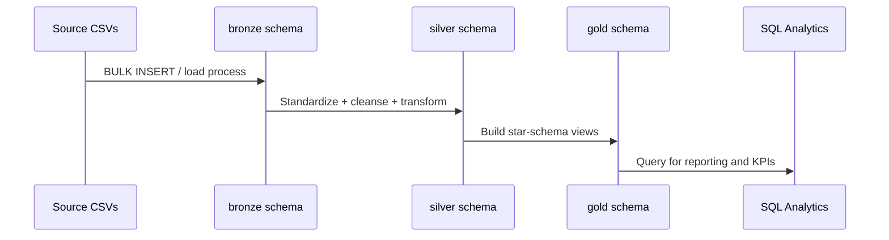
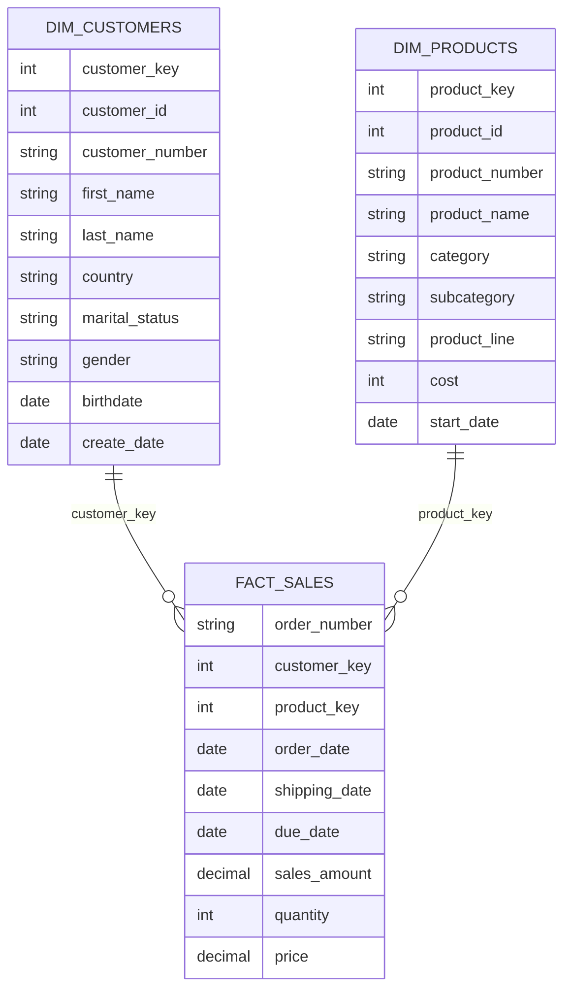

# Data Warehouse for Sales Analytics

A SQL Server-based data warehouse project that ingests CRM and ERP source data, cleans and standardizes it, and exposes a business-ready analytical model for sales and customer reporting.

## Why this project exists

Organizations often store operational data across multiple systems, each with different naming conventions, formats, and data quality issues. This creates a challenge when building analytical reports because the data is fragmented and inconsistent.

This project solves that problem by creating a medallion-style warehouse:

- Bronze: raw, source-aligned data
- Silver: cleaned, standardized, business-usable data
- Gold: star-schema-ready analytical views for reporting

The goal is to turn disconnected source files into a reliable source of truth for questions like:

- Which customers buy the most?
- Which product categories are growing?
- How do sales trends vary by region or customer segment?
- What is the relationship between product performance and customer behavior?

---

## Business context

This warehouse combines data from two source systems:

- CRM source: customer, product, and sales transactions
- ERP source: country, customer demographics, and product category metadata

The final output is designed to support operational reporting and business analysis without requiring a complex BI stack.

This is intentionally a practical, SQL-first warehouse implementation focused on data quality, logical modeling, and analytics readiness.

---

## Architecture overview



### Architecture intent

1. Raw files are loaded exactly as received into the Bronze layer.
2. The Silver layer resolves inconsistent values, trims whitespace, standardizes codes, and removes duplicate or invalid records.
3. The Gold layer creates a dimension-and-fact model suitable for SQL-based business analysis.
4. Reporting is performed directly on Gold-layer objects, keeping analysis simple and fast.

---

## Project flow



---

## What this project does

### 1. Ingests raw source data
The project reads CSV files from source folders and stores them in the `bronze` schema without changing business meaning.

This ensures raw data is preserved for auditability and troubleshooting.

### 2. Cleans and standardizes values
The Silver layer performs transformations such as:

- trimming spaces from names and code fields
- mapping short codes to business-friendly values
- removing duplicates
- resolving invalid or missing values
- converting raw date strings into usable SQL dates
- deduplicating records by latest valid record logic

### 3. Creates a star schema for analytics
The Gold layer exposes a simplified business model:

- `gold.dim_customers`
- `gold.dim_products`
- `gold.fact_sales`

This gives analysts a clean model for measuring performance and trends without joining raw source tables directly.

### 4. Validates quality before reporting
Quality scripts check for:

- duplicate keys
- nulls in critical fields
- invalid date sequences
- invalid numerical values
- referential integrity issues between fact and dimension data

---

## Source data

The project ingests data from CRM and ERP files in `datasets/`:

### CRM sources
- `datasets/source_crm/cust_info.csv`
- `datasets/source_crm/prd_info.csv`
- `datasets/source_crm/sales_details.csv`

These represent:
- customer master data
- product catalog information
- sales transactions

### ERP sources
- `datasets/source_erp/CUST_AZ12.csv`
- `datasets/source_erp/LOC_A101.csv`
- `datasets/source_erp/PX_CAT_G1V2.csv`

These provide:
- customer demographic and date metadata
- country/location mapping
- product category metadata

---

## Data warehouse design

### Layered model

#### Bronze layer
Purpose: keep raw source structure and original values.

Why it matters:
- preserves original data as received
- enables debugging and reprocessing
- supports traceability when source files change

Tables are created in the `bronze` schema and named using source system prefixes, for example:

- `bronze.crm_cust_info`
- `bronze.erp_cust_az12`
- `bronze.crm_sales_details`

#### Silver layer
Purpose: clean and standardize source data into a more reliable analytical structure.

Why it matters:
- removes noisy data
- creates consistent semantics across source systems
- reduces downstream reporting errors

#### Gold layer
Purpose: provide the final business-friendly analytical layer.

Why it matters:
- easier for analysts to query
- faster reporting
- cleaner business meaning with dimension/fact modeling

---

## Gold model



### Dimensions

#### `gold.dim_customers`
Represents customer level information and standardizes customer attributes from CRM and ERP.

#### `gold.dim_products`
Represents product-level metadata and category information, helping analyze product performance and category mix.

### Fact table

#### `gold.fact_sales`
Stores transactional sales records connected to customers and products.

This is the central table for revenue, quantity, and trend analysis.

---

## Folder structure

```text
DataWareHouse/
├── datasets/
│   ├── source_crm/
│   │   ├── cust_info.csv
│   │   ├── prd_info.csv
│   │   └── sales_details.csv
│   └── source_erp/
│       ├── CUST_AZ12.csv
│       ├── LOC_A101.csv
│       └── PX_CAT_G1V2.csv
├── docs/
│   ├── naming_conventions.md
│   └── requirements.md
├── scripts/
│   ├── database_init.sql
│   ├── bronze/
│   │   ├── ddl_bronze.sql
│   │   └── load_procedure_bronze.sql
│   ├── silver/
│   │   ├── ddl_silver.sql
│   │   └── load_procedure_silver.sql
│   └── gold/
│       └── ddl-gold.sql
├── tests/
│   ├── quality_checks_silver.sql
│   └── quality_checks_gold.sql
├── .gitignore
├── README.md
└── LICENSE (if present)
```

---

## How the loading process works

The project follows a simple production pattern:

### Step 1: Initialize database
Run `scripts/database_init.sql` to:

- create the `DataWarehouse` database
- create the `bronze`, `silver`, and `gold` schemas

### Step 2: Create Bronze tables
Run `scripts/bronze/ddl_bronze.sql` to define raw ingestion tables.

This preserves source fields and keeps the Bronze layer highly similar to the input datasets.

### Step 3: Load Bronze data
Run `scripts/bronze/load_procedure_bronze.sql`.

This procedure does a bulk load from the CSV files into the Bronze tables.

### Step 4: Create Silver tables
Run `scripts/silver/ddl_silver.sql` to define the cleaned transformation tables.

### Step 5: Transform into Silver
Run `scripts/silver/load_procedure_silver.sql`.

This stored procedure:

- removes duplicates
- standardizes values
- converts inconsistent codes to clean business values
- resolves product lifecycle logic
- shapes source records into a cleaner warehouse-friendly form

### Step 6: Create Gold layer
Run `scripts/gold/ddl-gold.sql`.

This builds the reporting layer from Silver using views:

- `gold.dim_customers`
- `gold.dim_products`
- `gold.fact_sales`

### Step 7: Run quality checks
Use the SQL files in `tests/` to validate data quality before using the warehouse for analysis.

---

## Important design decisions

### Why use Bronze, Silver, and Gold?
This is one of the cleanest ways to build a warehouse because it separates:

- raw ingestion
- data quality remediation
- business-ready reporting

This separation makes debugging and reprocessing much easier.

### Why use star schema in Gold?
Star schema is ideal for analytics because it simplifies reporting queries and improves readability for BI users.

In this project:

- dimensions describe people, products, and geography
- the fact table stores transactions
- joins are straightforward and intuitive

### Why standardize before reporting?
Without standardization, the same business value may appear as different strings across sources:

- `M` and `Male`
- `F` and `Female`
- `n/a` and blank values

Standardization reduces confusion and improves the reliability of analysis.

---

## Naming conventions

This project follows consistent naming rules documented in `docs/naming_conventions.md`.

Key principles:

- use lowercase snake_case
- keep names readable and business-oriented
- avoid reserved SQL keywords
- prefix source tables with source-system names in Bronze/Silver
- use business-aligned names in Gold

Examples:

- `bronze.crm_cust_info`
- `silver.erp_loc_a101`
- `gold.dim_customers`
- `gold.fact_sales`

---

## Data quality rules implemented

The project is designed to catch bad data early. The most important checks include:

- duplicate customer IDs or product IDs
- null or invalid key values
- inconsistent gender and marital status values
- invalid date ordering
- negative or null sales-related values
- missing relationships between fact and dimension records

These checks protect the integrity of downstream reporting.

---

## Example analytics supported

This warehouse enables questions such as:

- Which customers generate the highest total sales?
- Which product line performs best over time?
- Which regions have the strongest customer concentration?
- Are there product categories with abnormal sales patterns?
- How do customer attributes influence buying behavior?

The model is intentionally simple enough for direct SQL analysis and business interrogation.

---

## Setup requirements

To run this project, you need:

- Microsoft SQL Server
- access to a SQL Server instance with sufficient privileges
- the CSV files in the `datasets/` folder
- SQL Server tools or SSMS to run the scripts

### Suggested execution order

1. `scripts/database_init.sql`
2. `scripts/bronze/ddl_bronze.sql`
3. `scripts/bronze/load_procedure_bronze.sql`
4. `scripts/silver/ddl_silver.sql`
5. `scripts/silver/load_procedure_silver.sql`
6. `scripts/gold/ddl-gold.sql`
7. `tests/quality_checks_silver.sql`
8. `tests/quality_checks_gold.sql`

---

## Why this project is effective

This project is useful because it demonstrates a clean, realistic warehouse pattern that many businesses use in practice:

- source data is preserved
- business logic is separated by layer
- quality validation is built into the workflow
- final data is easy to query
- the model supports analytical decision-making

It is not just an academic exercise; it reflects the way enterprise data teams structure reporting pipelines.

---

## Documentation

Additional documentation is available in:

- `docs/requirements.md`
- `docs/naming_conventions.md`

These files explain the business requirements and naming standards used across the project.

---

## Summary

This project turns raw CRM and ERP CSV files into a clean, analytical, SQL-ready warehouse.

It focuses on the essentials that matter most:

- trustworthy data ingestion
- clean transformation logic
- quality validation
- a business-oriented analytical model
- direct support for reporting and insight generation

The result is a warehouse that is clear, maintainable, and useful for real business analysis.
