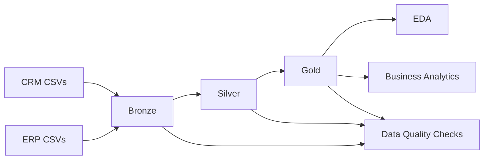

# SQL Data Warehouse & Analytics

An end-to-end SQL Server data warehouse project integrating CRM and ERP data, applying layered ETL transformations, and preparing trusted datasets for exploratory analysis and business analytics.

## Project Goals

- Consolidate data from CRM and ERP source systems.
- Build a maintainable Bronze–Silver–Gold pipeline.
- Clean, standardize, and validate data using T-SQL.
- Model customers, products, and sales for analytical queries.
- Keep exploratory data analysis and business analytics as separate workstreams.

## Architecture



| Layer | Responsibility | Main objects |
|---|---|---|
| Bronze | Raw source ingestion and traceability | Tables |
| Silver | Cleansing, standardization, deduplication, integration | Tables |
| Gold | Business-ready dimensional model | Views |
| EDA | Explore distributions, data quality, relationships, and patterns | SQL and notebooks |
| Analytics | Answer business questions and derive KPIs | SQL analyses and reports |

## Repository Structure

This folder is one of three top-level project folders (`Warehouse/`, `EDA/`, `analytics/`). Paths below are relative to `Warehouse/`.

```text
Warehouse/
├── datasets/
│   ├── source_crm/
│   └── source_erp/
├── scripts/
│   ├── database_init.sql
│   ├── bronze/
│   ├── silver/
│   └── gold/
├── tests/
├── docs/
└── README.md
```

**Folder conventions**
- `datasets/` holds the original CRM and ERP CSV files.
- `scripts/` holds the stable database, Bronze, Silver, and Gold SQL.
- `tests/` contains repeatable data-quality checks for Silver and Gold.
- `docs/` contains requirements, naming conventions, the data catalog, and project diagrams.
- Exploratory SQL lives in `../EDA/`; business-question SQL, quality checks, and insights live in `../analytics/`.

## Source Data

| System | File | Purpose |
|---|---|---|
| CRM | `cust_info.csv` | Customer master data |
| CRM | `prd_info.csv` | Product master data |
| CRM | `sales_details.csv` | Sales transactions |
| ERP | `CUST_AZ12.csv` | Customer demographic attributes |
| ERP | `LOC_A101.csv` | Customer location and country |
| ERP | `PX_CAT_G1V2.csv` | Product category metadata |

## Implementation Status

- Database and Bronze/Silver/Gold schemas initialized (`scripts/database_init.sql`).
- Bronze tables and CSV ingestion procedure (`bronze.load_bronze`).
- Silver tables and transformation procedure (`silver.load_silver`).
- Gold views: `gold.dim_customers`, `gold.dim_products`, `gold.fact_sales`.
- Silver and Gold quality checks in `tests/`.
- EDA scripts in `../EDA/` and business analytics in `../analytics/`.

## Observed Silver Load

The following counts were observed after executing the Silver load procedure:

| Silver table | Rows |
|---|---:|
| `crm_cust_info` | 18,484 |
| `crm_prd_info` | 397 |
| `crm_sales_details` | 60,398 |
| `erp_cust_az12` | 18,483 |
| `erp_loc_a101` | 18,484 |
| `erp_px_cat_g1v2` | 37 |

These are observed execution results, not hard-coded expectations for every dataset version.

## Technology Stack

- Microsoft SQL Server 2025
- T-SQL
- DBeaver
- Ubuntu Linux
- CSV ingestion with `BULK INSERT`
- Git and GitHub
- SQL-based data-quality checks

## Setup and Execution

### 1. Configure source files

Keep the six original CSV files under `datasets/source_crm/` and `datasets/source_erp/`.

The current Bronze loader reads files from the SQL Server host directory:

```text
/var/opt/mssql/import/
```

Update the paths in `scripts/bronze/load_procedure_bronze.sql` if your SQL Server import directory differs. The files must be readable by the SQL Server service account.

### 2. Initialize the database

Review `scripts/database_init.sql` before running it. The script creates `DataWarehouse` if it does not already exist and creates the three schemas when missing. It does not drop an existing database.

### 3. Create and load Bronze

Execute:
1. `scripts/bronze/ddl_bronze.sql`
2. `scripts/bronze/load_procedure_bronze.sql`

Then run:

```sql
EXEC bronze.load_bronze;
```

### 4. Create and load Silver

Execute:
1. `scripts/silver/ddl_silver.sql`
2. `scripts/silver/load_procedure_silver.sql`

Then run:

```sql
EXEC silver.load_silver;
```

### 5. Build Gold

Execute `scripts/gold/ddl_gold.sql`. The intended reporting views are:

- `gold.dim_customers`
- `gold.dim_products`
- `gold.fact_sales`

Verify that each view returns the expected rows before using it for analysis.

### 6. Run data-quality checks

Run the scripts in `tests/` after loading the corresponding layer. Investigate unexpected rows rather than assuming every check should always return zero without understanding its rule.

For SQL Server scripts containing `GO`, use DBeaver's **Execute SQL Script** action so batch separators are handled correctly.

## Key Engineering Concepts

- Medallion Architecture
- Full-load ETL with stored procedures
- Bulk ingestion
- Data standardization and cleansing
- Deduplication with `ROW_NUMBER()`
- Product lifecycle logic with `LEAD()`
- Date validation and conversion
- Dimensional modeling and Star Schema
- Surrogate keys and fact-to-dimension joins
- Data quality and referential-integrity checks

## Documentation

- [Requirements](docs/requirements.md)
- [Naming conventions](docs/naming_conventions.md)
- [Gold data catalog](docs/data_catalog.md)
- [Project diagrams](docs/)

## Author

**Abhishek Kr Prajapati**  
GitHub: [@abhishekkp00](https://github.com/abhishekkp00)

---

A practical Data Engineering and Analytics portfolio project.
